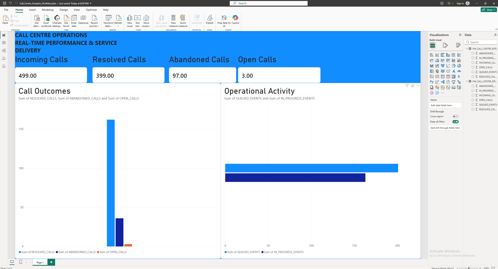

# Real-Time Call Centre Analytics

An end-to-end streaming analytics project that simulates call centre activity, processes operational events in real time, and delivers continuously updated KPIs through a Power BI dashboard.

## Project Overview

Traditional reporting often relies on batch processing, meaning operational performance may only become visible after scheduled data refreshes.

This project demonstrates an alternative approach using event-driven architecture and stream processing.

A Python-based call simulator generates call centre events and sends them to both SQL Server and Apache Kafka. Apache Flink processes the incoming Kafka events and calculates operational KPIs. The aggregated results are streamed into Snowflake, where Power BI connects to the latest data using DirectQuery.

The result is a working real-time analytics prototype that demonstrates how operational data can move from event generation to business intelligence.
## Dashboard Preview


## Architecture

flowchart TD
    A["Python Call Simulator"]
    B[("SQL Server")]
    C[["Kafka: call-events"]]
    D["Apache Flink"]
    E[["Kafka: call_centre_kpi_output"]]
    F["Snowflake Sink Connector"]
    G[("Snowflake Analytics Warehouse")]
    H["Power BI DirectQuery Dashboard"]

    A -->|"Operational records"| B
    A -->|"Call events"| C
    C --> D
    D -->|"KPI snapshots"| E
    E --> F
    F --> G
    G --> H

## Technology Stack

| Technology | Purpose |
|---|---|
| Python | Simulates call centre activity and generates events |
| SQL Server | Stores operational call centre data |
| Apache Kafka | Transports call events as a stream |
| Apache Flink | Processes streaming events and calculates KPIs |
| Snowflake | Stores processed KPI snapshots |
| Power BI | Visualises operational performance |
| Ubuntu on WSL2 | Python development environment |

## Data Pipeline

### 1. Event Generation — Python

A Python call simulator generates realistic call centre activity, including:

- Incoming calls
- Queued calls
- Abandoned calls
- Agent assignments
- Calls in progress
- Resolved calls

The simulator writes operational records to SQL Server and publishes event messages to Kafka.

### 2. Event Streaming — Apache Kafka

Kafka acts as the event streaming layer.

The `call-events` topic receives the simulated call events, making them available for downstream processing.

### 3. Stream Processing — Apache Flink

Apache Flink consumes the incoming Kafka events and calculates operational performance metrics.

The processed KPI snapshots are published to the `call_centre_kpi_output` Kafka topic.

### 4. Data Warehousing — Snowflake

A Snowflake Sink Connector ingests the KPI output topic into Snowflake.

The processed data is stored in the `CALL_CENTRE_DB` database, within the `ANALYTICS` schema.

A Snowflake view, `VW_CALL_CENTRE_KPIS`, exposes the latest KPI snapshot for reporting.

### 5. Business Intelligence — Power BI

Power BI connects to Snowflake using DirectQuery.

Automatic Page Refresh is configured at a 30-second interval in Power BI Desktop, allowing dashboard visuals to reflect newly processed KPI data without relying on a traditional Import-mode refresh.

## Key Performance Indicators

The dashboard tracks:

| KPI | Description |
|---|---|
| Incoming Calls | Total incoming calls recorded |
| Resolved Calls | Calls successfully resolved |
| Abandoned Calls | Calls abandoned before resolution |
| Open Calls | Calls not yet resolved or abandoned |
| Queued Events | Number of calls entering the queue |
| In-Progress Events | Number of calls entering the in-progress state |

**Important:** The Flink output represents KPI snapshots rather than individual call records. The Snowflake reporting view selects the latest snapshot to avoid incorrectly adding together historical cumulative totals.

## Key Technical Concepts Demonstrated

- Event-driven architecture
- Real-time data streaming
- Kafka producers and consumers
- Stream processing with Apache Flink
- SQL Server database integration
- Cloud data warehousing with Snowflake
- Data transformation and KPI aggregation
- DirectQuery reporting
- Automated dashboard page refresh
- Python database connectivity
- End-to-end data pipeline integration

## Repository Structure

```text
real-time-call-centre-analytics/
│
├── call_simulator.py
├── kafka_test.py
├── test_connection.py
├── PROJECT_PROGRESS.md
├── .gitignore
└── README.md
```

## Project Status

**Working prototype — end-to-end pipeline implemented and tested.**

The Python simulator, SQL Server integration, Kafka event streaming, Flink processing, Snowflake ingestion and Power BI DirectQuery dashboard have been connected and tested.

## Future Improvements

- Introduce automated data quality checks.
- Add historical KPI trend analysis.
- Implement more advanced operational metrics.
- Improve pipeline monitoring and error handling.
- Expand the dashboard with additional business insights.
- Improve configuration and deployment portability.

## About This Project

This project was developed as a practical exercise in modern data engineering and business intelligence.

The objective was to understand how operational systems, streaming technologies, cloud data platforms and visualisation tools work together to transform raw events into actionable business insights.

It combines data engineering concepts with business analytics to demonstrate the journey from raw operational data to decision-ready information.
